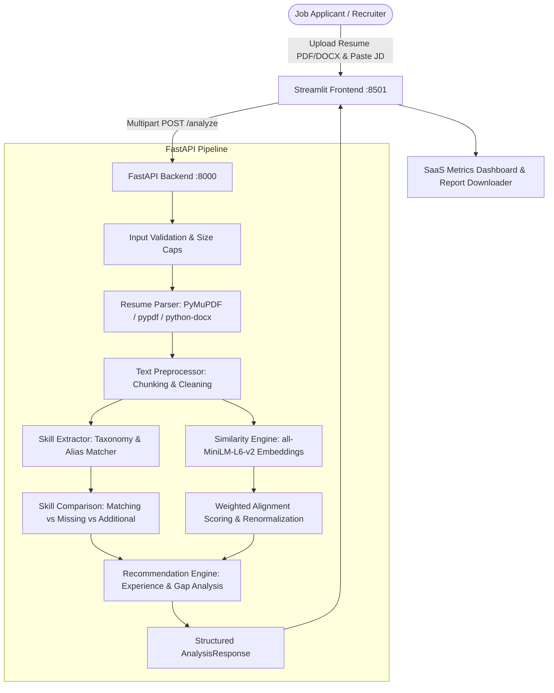

# AI Resume & Job Description Matcher 🎯

An intelligent, explainable, production-ready AI application that helps candidates, job seekers, and recruiters evaluate how accurately a resume aligns with a specific job description using local NLP, sentence transformers, skill taxonomy parsing, and actionable gap analysis.

---

## 📌 Problem Statement

Traditional Applicant Tracking Systems (ATS) and keyword search engines frequently fail job applicants:
- **Keyword Stuffing Bias**: Simple string matchers miss synonyms and contextual evidence.
- **Black-Box Scoring**: Opaque machine learning algorithms provide arbitrary scores without explaining *why* a candidate fell short.
- **False Hallucinations**: Cloud LLM prompts frequently fabricate credentials or invent non-existent experience.
- **Privacy Risks**: Uploading personal resumes with sensitive contact info to third-party paid APIs exposes personal data.

**AI Resume & Job Description Matcher** addresses these challenges by running transparent, locally executed NLP algorithms that provide explainable weighted metrics, explicit evidence snippets, false-positive prevention, and truthful recommendations.

---

## ✨ Features

- **Multi-Format Resume Ingestion**: Robust text extraction from `.pdf` and `.docx` files with in-memory validation, size caps (5 MB), and corrupted/scanned file detection.
- **Vector Semantic Similarity**: Chunk-aware sentence embeddings using `sentence-transformers/all-MiniLM-L6-v2` to prevent token cutoffs on lengthy resumes.
- **Hierarchical Skill Taxonomy**: Extracts technical skills across Programming Languages, AI/ML, Data, Backend, Frontend, Cloud, DevOps, and Engineering fundamentals.
- **Alias & False-Positive Prevention**: Automatically standardizes aliases (`sklearn` ➔ `Scikit-Learn`, `k8s` ➔ `Kubernetes`) while preventing substring false positives for short words like `C`, `R`, and `Go`.
- **Requirement Separation**: Distinguishes between **Required Prerequisite Skills** and **Preferred / Nice-to-Have Skills**.
- **Transparent Weighted Scoring**:
  - Semantic Similarity Score (40%)
  - Required Skill Coverage (40%)
  - Preferred Skill Coverage (20%)
  - *Dynamic Renormalization*: Re-weights proportionally when preferred skills are absent from job descriptions.
- **Truthful Recommendation Engine**: Identifies missing credentials, weak action verbs, and unevidenced skills. Offers structured suggestions and illustrative rewrite templates without ever fabricating work experience or metrics.
- **Interactive SaaS Dashboard**: Polished Streamlit frontend featuring progress bars, evidence accordions, score distributions, and responsive cards.
- **Multi-Format Report Export**: One-click download of the complete analysis report as Markdown (`.md`) or structured JSON (`.json`).
- **Privacy-First Design**: Zero permanent resume storage, no telemetry of personal data, and zero external paid API dependencies.

---

## 🛠️ Technology Stack

| Component | Technology | Description |
| :--- | :--- | :--- |
| **Frontend** | [Streamlit](https://streamlit.io/) | Interactive dashboard and report visualization |
| **Backend API** | [FastAPI](https://fastapi.tiangolo.com/) | High-performance asynchronous REST API server |
| **ASGI Server** | [Uvicorn](https://www.uvicorn.org/) | Production-grade ASGI server with hot-reload |
| **Embeddings & NLP** | [Sentence Transformers](https://www.sbert.net/) | `all-MiniLM-L6-v2` dense vector representations |
| **Text Processing** | [scikit-learn](https://scikit-learn.org/) | Cosine similarity metrics & TF-IDF fallback |
| **PDF Extraction** | [PyMuPDF](https://pymupdf.readthedocs.io/) & [pypdf](https://pypdf.readthedocs.io/) | High-fidelity text extraction with dual-engine fallback |
| **DOCX Extraction** | [python-docx](https://python-docx.readthedocs.io/) & Native XML | Word document parsing with zero-dependency fallback |
| **Data Validation** | [Pydantic v2](https://docs.pydantic.dev/) | Strict typed request and response schemas |
| **Testing** | [pytest](https://docs.pytest.org/) & TestClient | Automated test suite with fast offline mocks |

---

## 🏗️ Architecture & Workflow



---

## 📂 Project Structure

```
AI-Resume-Matcher/
├── frontend/
│   └── app.py                     # Streamlit web application & UI components
├── backend/
│   ├── main.py                    # FastAPI application, CORS, lifespan, & status
│   ├── config.py                  # Pydantic BaseSettings & environment config
│   ├── routes/
│   │   ├── __init__.py
│   │   └── analyze.py             # /analyze and /extract-resume endpoints
│   ├── schemas/
│   │   ├── __init__.py
│   │   └── analysis.py            # Pydantic request/response data models
│   └── services/
│       ├── __init__.py
│       ├── resume_parser.py       # PDF/DOCX multi-engine extractor & section detector
│       ├── text_preprocessor.py   # Overlapping word chunking & snippet isolation
│       ├── skill_extractor.py     # Skill taxonomy, regex alias matching, & requirement splitter
│       ├── similarity_engine.py   # SentenceTransformer embeddings & TF-IDF fallback
│       ├── recommendation_engine.py # Experience, education, & truthful advice generation
│       └── report_generator.py    # Markdown and JSON report exporter
├── tests/
│   ├── conftest.py                # Pytest configuration & offline mock fixtures
│   ├── test_api.py                # FastAPI endpoint integration & validation tests
│   ├── test_resume_parser.py      # PDF, DOCX, empty, corrupt, & scanned file tests
│   ├── test_skill_extractor.py    # Aliases, false-positive prevention, & coverage tests
│   ├── test_similarity_engine.py  # Cosine similarity, score clamping, & weight tests
│   ├── test_recommendations.py    # Advice generation & experience comparison tests
│   └── test_integration_model.py  # Optional live pretrained model test
├── sample_data/
│   └── sample_job_description.txt # Fictional sample job posting for testing
├── .github/
│   └── workflows/
│       └── tests.yml              # Automated GitHub Actions CI workflow
├── .env.example                   # Environment configuration template
├── .gitignore                     # Git ignore rules for Python, cache, and models
├── pytest.ini                     # Pytest runner configuration
├── requirements.txt               # Locked stable dependencies
├── LICENSE                        # MIT Open Source License
├── README.md                      # Comprehensive project documentation
└── run.py                         # Single-command launcher for both services
```

---

## 🚀 Quickstart & Installation

### 1. Clone the Repository

```bash
git clone https://github.com/your-username/AI-Resume-Matcher.git
cd AI-Resume-Matcher
```

### 2. Set Up a Virtual Environment

**Windows (PowerShell):**
```powershell
python -m venv venv
.\venv\Scripts\Activate.ps1
```

**macOS / Linux:**
```bash
python3 -m venv venv
source venv/bin/activate
```

### 3. Install Dependencies

```bash
pip install --upgrade pip
pip install -r requirements.txt
```

### 4. Configuration (Optional)

Copy `.env.example` to `.env` to customize settings:
```bash
cp .env.example .env
```

---

## 🏃 Running the Application

### Option A: Unified Launcher (Recommended)

Start both the FastAPI backend and Streamlit frontend simultaneously with clean graceful shutdown:

```bash
python run.py
```

- **Streamlit Frontend**: [http://localhost:8501](http://localhost:8501)
- **FastAPI Backend**: [http://127.0.0.1:8000](http://127.0.0.1:8000)
- **Swagger Interactive API Docs**: [http://127.0.0.1:8000/docs](http://127.0.0.1:8000/docs)

---

### Option B: Manual Startup (Two Terminals)

**Terminal 1 — Backend (FastAPI):**
```bash
uvicorn backend.main:app --host 127.0.0.1 --port 8000 --reload
```

**Terminal 2 — Frontend (Streamlit):**
```bash
streamlit run frontend/app.py
```

---

## 🧪 Running Automated Tests

Run the complete automated test suite (all unit tests execute locally in ~2 seconds):

```bash
pytest
```

To run verbose test output:
```bash
pytest -v
```

To run the optional live pretrained model integration test (requires active internet connection to download Hugging Face weights):
```bash
pytest -v --run-integration
```

---

## 📡 API Reference

### 1. Root Status
`GET /`
```json
{
  "app_name": "AI Resume & Job Description Matcher",
  "version": "1.0.0",
  "status": "online",
  "docs_url": "/docs",
  "health_url": "/health"
}
```

### 2. Service Health
`GET /health`
```json
{
  "status": "healthy",
  "model_loaded": true,
  "model_name": "sentence-transformers/all-MiniLM-L6-v2",
  "supported_formats": ["PDF (.pdf)", "Word (.docx)"]
}
```

### 3. Analyze Resume
`POST /analyze`  
*Content-Type: `multipart/form-data`*

**Parameters:**
- `resume`: Binary file (`.pdf` or `.docx`)
- `job_description`: Full string text of the job description
- `target_job_title` *(optional)*: String title of the role

**Example JSON Response:**
```json
{
  "target_job_title": "Senior Python / AI Engineer",
  "scores": {
    "overall_score": 82.5,
    "semantic_score": 75.0,
    "required_skill_score": 85.7,
    "preferred_skill_score": 75.0,
    "weights_applied": {
      "semantic_weight": 0.4,
      "required_skill_weight": 0.4,
      "preferred_skill_weight": 0.2
    },
    "disclaimer": "Scores represent textual alignment between the submitted resume and job description. They do not constitute hiring probabilities or automated employment decisions."
  },
  "matching_skills": [
    {
      "name": "FastAPI",
      "category": "Backend Development",
      "is_required": true,
      "evidence_snippet": "Engineered RESTful APIs with FastAPI and PostgreSQL.",
      "section_found": "Resume"
    }
  ],
  "missing_skills": [
    {
      "name": "Kubernetes",
      "category": "DevOps & Infrastructure",
      "is_required": true,
      "evidence_snippet": "Experience deploying services with Kubernetes required.",
      "section_found": "Job Description"
    }
  ],
  "additional_skills": [],
  "experience_analysis": {
    "sections_detected": ["Summary", "Skills", "Experience", "Education"],
    "observations": ["Observed quantified metrics (6 instances found)."],
    "education_detected": ["Bachelor's Degree or Equivalent"],
    "experience_years_comparison": "Experience target aligned: Job description requests ~3+ years, and resume mentions 5 years."
  },
  "recommendations": [
    {
      "issue": "High-priority required skills not evidenced in your resume: Kubernetes",
      "why_it_matters": "These skills are explicit prerequisites for Senior Python / AI Engineer.",
      "recommended_action": "If you have used this technology, explicitly mention it in your project descriptions.",
      "example_rewrite": "• Developed scalable backend feature integrating Kubernetes, ensuring test-driven coverage.",
      "user_verification_notice": "Please review all suggested text for 100% accuracy and truthfulness before adopting."
    }
  ],
  "resume_word_count": 340,
  "jd_word_count": 280,
  "processing_time_seconds": 0.85
}
```

---

## 📸 Screenshots

| Dashboard Overview | Skills Breakdown & Recommendations |
| :---: | :---: |
| *[Screenshot: Alignment Dashboard with Score Cards & Visualizations]* | *[Screenshot: Skills Accordion & Actionable Suggestions]* |

---

## 🔒 Security & Privacy Safeguards

- **In-Memory Processing**: Uploaded documents are parsed in temporary memory streams and discarded immediately after processing.
- **No Telemetry / No Logging**: Resume text and personal identifying information (PII) are never printed to terminal logs or stored in databases.
- **Size & Format Whitelisting**: Strict 5 MB maximum size restrictions and strict file extension verification prevent malicious or oversized payloads.
- **No Malicious Code Execution**: Files are read strictly as data streams via sandboxed parsers.

---

## ⚠️ Known Limitations

- **Scanned Image PDFs**: Does not perform Optical Character Recognition (OCR) on flat image scans. Scanned documents will return a prompt advising the user that text-searchable PDFs or DOCX files are required.
- **Heuristic Taxonomy**: Skill coverage is determined by the open-source taxonomy. Niche proprietary company tools not in standard taxonomies can be easily added to `backend/services/skill_extractor.py`.

---

## 🗺️ Future Enhancements

- [ ] Export analysis report directly as a formatted PDF.
- [ ] Multi-job description comparison to find the best role match.
- [ ] User-customizable skill taxonomy through UI settings.
- [ ] Docker Compose deployment template.

---

## 📄 License & Contributing

Distributed under the **MIT License**. See [`LICENSE`](LICENSE) for details. Contributions, issues, and feature requests are welcome!
